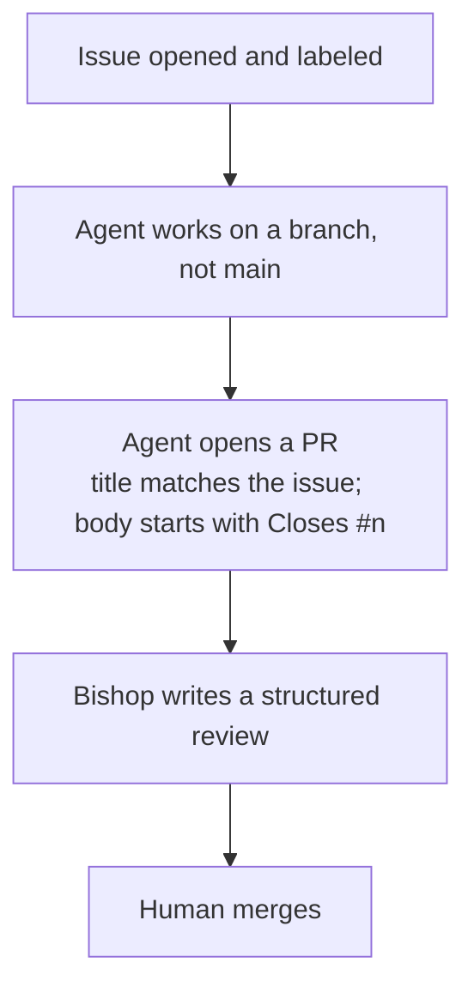

# Nextimus agent pipeline

**Evidence:** Private, described, from the private repo's process docs and from PR/issue history reviewed 18 Nov 2026.

The loop is:

1. An issue is opened and labeled with a lane (mine, or the human collaborator's) and an area such as code or art.
2. An agent works on a branch named for the issue, not on `main`.
3. The agent opens a pull request. The title matches the issue title, and the body starts with `Closes #<n>`.
4. Bishop, one of my agents, writes a structured review: Summary, Blockers, Should fix, Nits, Safety, Tests, and Done when.
5. A human merges. Agents are not allowed to commit to `main` or to merge themselves.

Agents do not commit to `main` and do not merge themselves. Playtests that start a server or bots are supposed to pass three consecutive runs at `--playtest-speed=4` before a merge; known flakes stay listed as flakes.

I use Rook for gameplay, sim, networking, tests, and playtests; Knight for art and UI; Bishop for review; and GPT Codex on harder or alternate implementation work. Claude Code is the usual implementation tool on my lane, with SuperGrok used for planning and review as well. The collaborator's agents stay generic in this write-up.

## Tests, in two layers

There is a headless **rule suite** (`res://tests/run.tscn`) that is documented to print `ALL TESTS PASSED` or `FAIL:` lines. There is also a bot-driven **playtest** suite that is supposed to use real player input — clicks and hotkeys — rather than debug teleports.

Conventions I care about, written into the project docs:

- Playtests must exercise a feature the way a player would.
- They must not depend on luck, and they must not skip steps to save time.
- Debug setup needs my OK, plus an open "redo" issue.
- Playtests that start a server or bots should pass **three consecutive** runs at `--playtest-speed=4`.
- Known flakes are listed as flakes. We do not weaken an assertion just to get a green run.

Ports are isolated per agent so parallel Godot processes do not collide. I am not publishing the workstation's port map as if it were a public service; the idea is simply "don't share the default port."

## What this is not

Networking is ENet on a LAN and is not DTLS-hardened. There is no public server. Some playtests are still flaky — including a `server_walk` case that was later called out in PR #320. The 10-part GameSim split (PRs #303–#317, 13–14 Nov 2026) is what happens when a core file gets too large to review honestly: extract, keep the playtests, and merge in pieces.

I merge the work. I do not pretend I typed every line.
