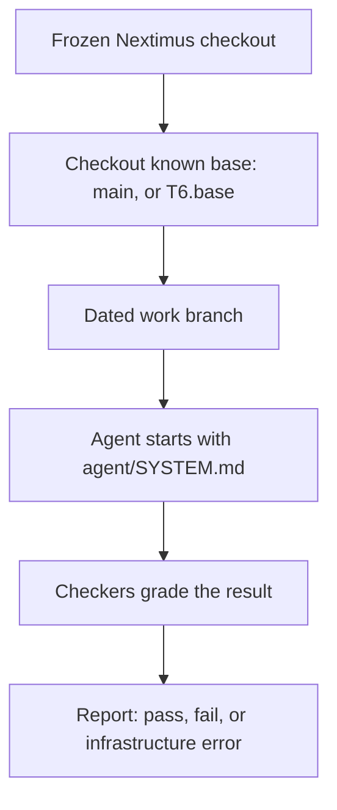

# pawn-bench harness

**Evidence:** Verified in this repo. The sanitized scripts are in [examples/pawn-bench/](../examples/pawn-bench/).

`run.sh` is the entry point: `run.sh <T1..T16> <model alias>`. Optional environment variables cover thinking level, timeouts, whether a failed check may be retried (`FIX`), and whether the agent is launched through OpenClaw (the default) or a direct [LM Studio](https://lmstudio.ai/) path.

A typical run:

1. The harness uses a frozen Nextimus checkout (in this published copy, the path comes from `NEXTIMUS_PAWN`, not from a hard-coded home directory).
2. It checks out a known base (`main`, or `tasks/T6.base` for the save-compatibility task).
3. It creates a dated work branch and starts an externally configured OpenClaw agent named `pawn`. The published `agent/SYSTEM.md` is the prompt that belongs in that OpenClaw agent config; `run.sh` does not pass the file in. The optional `AGENT=direct` path does load `agent/SYSTEM.md` by default. The public copy cannot prove what is installed in a local OpenClaw setup.
4. Checkers grade the result. For Blender tasks those checkers are `glb_check.py`, `kit_check.py`, `kit_loadout.py`, and the house library `pare_lib.py`.
5. Infrastructure and provider errors are not scored as model failures. Interrupting a run is supposed to clean up and return the checkout to `main`.

Infrastructure and provider errors are not scored as model failures. A reader can run the [synthetic checker fixture](../examples/pawn-bench/fixtures/) without that private checkout; a full task rerun cannot. See [REPRODUCING.md](../examples/pawn-bench/REPRODUCING.md).

`night-1114.sh` is a thin wrapper that runs the 14 Nov 2026 overnight set from the script directory. In this published copy it no longer assumes a particular home path.

Model alias `q36` is Qwen3.6 35B A3B MLX in LM Studio. Other aliases exist in `run.sh` for local and API models; I am not turning this page into a vendor comparison. The skill file `skills/blender-rigged-pare/SKILL.md` is what the art tasks are supposed to follow.

Quaternius Source packs used by T8–T16 are CC0 1.0. Point `QUATERNIUS_SOURCE` at a local copy if you rerun those tasks (`KIT_SOURCES` is a fallback alias). The scripts do not auto-load `.env`. I did not author the meshes, and this repository does not include the packs.

Raw transcripts, `pawn-logs/`, and handoff notes are not in this repo. See [examples/pawn-bench/RESULTS-SUMMARY.md](../examples/pawn-bench/RESULTS-SUMMARY.md) for the cleaned 16/16 summary.
