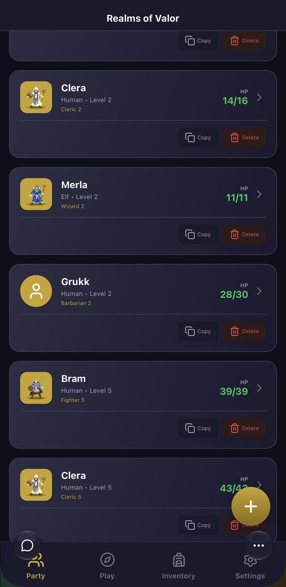
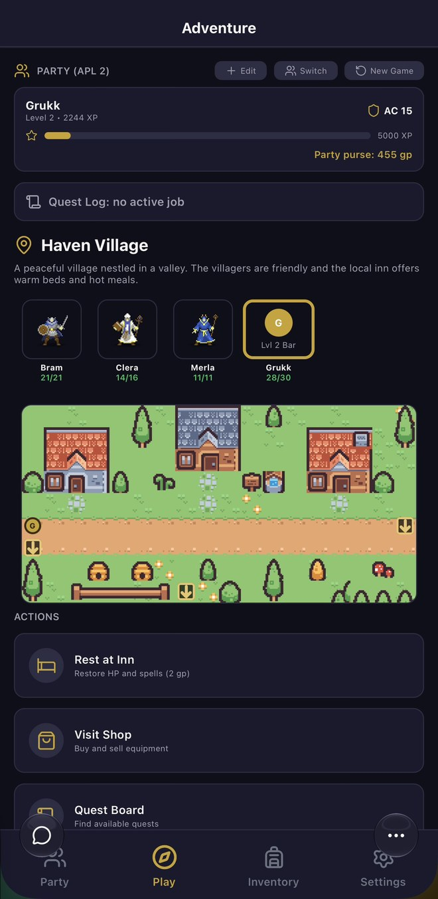
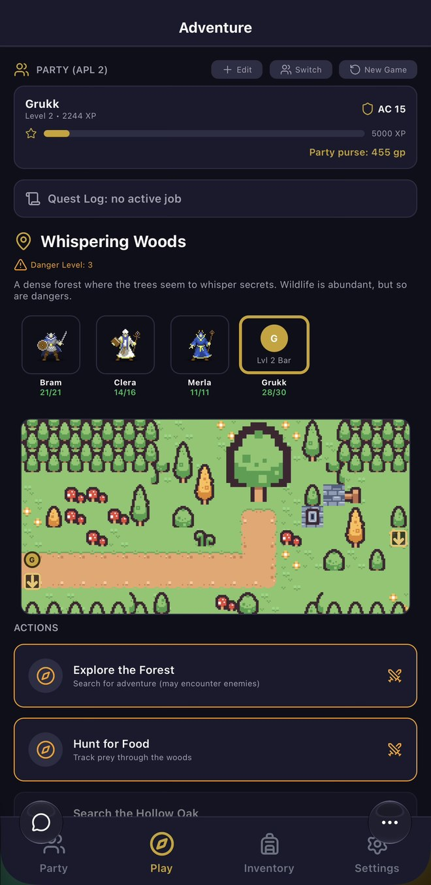
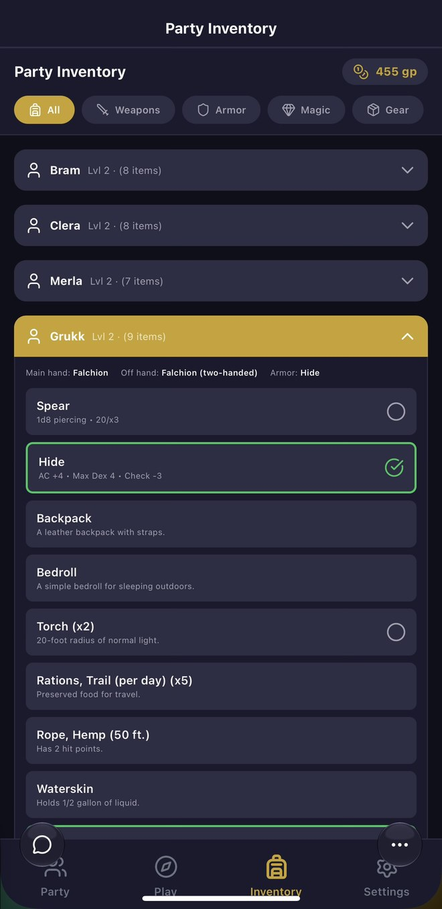
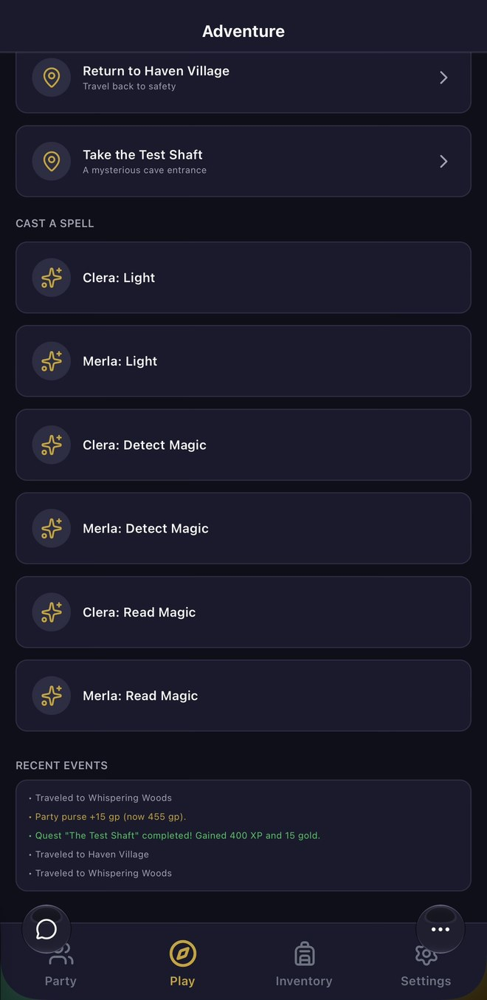

# D20 Forge

**Problem:** Build a mobile d20 game I could actually play, with party, adventure, and inventory, as an early AI-assisted project.  
**Role:** I owned the design, the prompts, and the decisions about what belonged in v0. Agents in Vibecode did the implementation.  
**Tools:** Vibecode / Expo / React Native.  
**Outcome:** A v0 prototype, in-app name Realms of Valor, with in-app screenshots in this repo.  
**Evidence:** Private source, described. Prototype (the in-app version is labeled v0). In-app screenshots verified in this repo. The application code was not copied into this repository. Dates, stack pins, and naming history are in the [evidence index](../EVIDENCE.md).  
**Limitations:** This is a v0 prototype, not a production mobile app. There is no `test` script, and I did not run lint or typecheck for this portfolio, so I have no passing count to quote. The source stays private.

D20 Forge is a mobile d20 game I had built so I could actually play it. The in-app title is **Realms of Valor**. Agents in Vibecode did the implementation; I owned the design, the prompts, and the decisions about what belonged in v0.

## What a player can do

A player can build and keep a **party of up to four**, walk through a ten-step character creator, and open a character sheet that supports level-up, including adding a class. The Adventure tab is the loop I cared about: travel between places, explore, fight, rest, shop, pick up quests, and cast a small set of spells. There is a party inventory, a dice tab, and a recent-events log.

The data behind that loop comes from the d20 [SRD](https://en.wikipedia.org/wiki/System_Reference_Document) under the Open Game License 1.0a: seven races, eleven core classes, 35 skills, and a 272-spell SRD 3.5 list, with a subset actually wired to combat or to location effects such as Light and Detect Magic. Places like Haven, the Whispering Woods, and the Forgotten Crypt have danger tiers and skill challenges.

## Design decisions that were mine

- The in-app title is original. The rules are an OGL 3.5 / Pathfinder hybrid as described in a later handoff: mechanics from the SRD, with no Product Identity — no Golarion, and no official unique names.
- v0 was meant to be playable, not complete. Battle maps, more town NPCs, day/night, and more of the bestiary were on the backlog; some of that landed, and some of it is still design. I am not going to pretend the tree was a finished commercial app. The handoff itself labels that snapshot **v0**.
- Map tiles are [Kenney](https://kenney.nl/) Tiny Town / Tiny Dungeon (**CC0**). Character portraits come from a commercially licensed sprite pack I did not author. The raw sprite files are not in this repository.
- A Hono / Prisma / SQLite backend with better-auth is documented for future cloud sync and login, not as the heart of the local game.

The application README says the application code is **proprietary** and the game content is under **OGL 1.0a**. I did not copy `.env` files, a local SQLite dev database, or the source tree itself.

## What the app looks like

These are iPhone screenshots of the running v0 app (in-app title **Realms of Valor**). I cropped off the iOS status bar and the "App Store" back label, stripped EXIF/GPS, and resized them for the web.

*Party tab, scrolled down, showing two test parties of up to four. Visible here: three members of the level-2 test party I played up from level 1 (Clera, Human Cleric 2; Merla, Elf Wizard 2; Grukk, Human Barbarian 2, placeholder initial — Bram is the fourth member of that party, seen in the Haven, Woods, and Inventory stills) and two members of a separate level-5 test party (Bram, Human Fighter 5, and a second Clera at Cleric 5).*

*Adventure tab, Haven Village. The party bar, a Kenney-tiled village map, and actions to rest at the inn, visit the shop, or open the quest board.*

*Adventure tab, Whispering Woods, danger 3. The same four-member level-2 test party as the Haven and Inventory stills (Bram, Clera, Merla, and Grukk), a Kenney-tiled forest map, and explore / hunt actions.*

*Party Inventory, with Grukk's list expanded: falchion in both hands, hide armor equipped, plus everyday gear. Party purse 455 gp.*

*Adventure tab, scrolled down: travel back to Haven or into the Test Shaft, a Cast a Spell list (Light, Detect Magic, Read Magic on Clera and Merla), and a recent-events log that includes completing "The Test Shaft."*

Dates, the January-to-October gap, Expo pin details, and naming history (including why a Prisma folder is treated as a template stamp) are in the [evidence index](../EVIDENCE.md).
