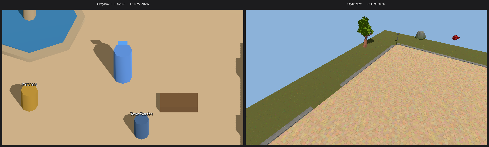

# Nextimus

**Evidence:** Private, described. Prototype (version 0.1.0 graybox, not a shipped game).  
**Where the evidence lives:** a private GitHub repository. Counts below are from a review on 18 Nov 2026, America/Chicago, plus a later read of PR #287. I have not copied the private tree into this portfolio.

Nextimus is a [Godot](https://godotengine.org/) 4.7.2 graybox — a playable, programmer-art slice — for a persistent online game with Good and Evil factions. It is a spiritual successor to Xenimus, not a clone, and it has no Xenimus names, spells, towns, or assets. I started the repo on 20 Sep 2026. Work was still landing through the merge of PR #320 on 14 Nov 2026, 9:38 PM America/Chicago (CST).

As of 18 Nov 2026 the private repo had **156 pull requests, 145 merged**, and **18 open issues**.

I did this with a human collaborator and with agents on both sides. My agents include Rook, Knight, and Bishop. The collaborator's agents are credited only as such. I own the design calls and the merges. Agents do most of the implementation, test writing, and review drafts, using Claude Code, GPT Codex, SuperGrok, and the same local Qwen setup I use elsewhere.

## The camera call I would not leave to a model

By mid-November the graybox could move, fight, and play through quests, but the follow camera still did not feel like the game I had in my head. I wrote the numeric target myself on 12 Nov 2026, 11:44 AM America/Chicago (CST), rather than asking a model to "make it feel close."

The call, in full in [examples/camera-spec.md](../examples/camera-spec.md):

- **Orthographic** projection (no perspective), so the ground scale is even on every side of the player.
- One **size of 7.25 m** (the vertical extent of the view) for both angles. Toggling views changes only the pitch, never the zoom or the framing.
- Camera due south, looking north, 30 m back. In ortho, that distance does not change scale; it just keeps the near plane from clipping.
- The **screen centre is the player's feet**.
- Angled view **50°** down; top-down **72°** down.
- Characters stay authored at about 1.8 m. A **1.25×** scale is applied on the visual node (a bench Knight at 1.81 m becomes about 2.26 m on screen). Walk collision and the 7.5 m/s walk speed stayed where they were; pace was tracked in a separate issue.

Claude Code implemented that in PR #287 (issue #284), titled "Camera: Xenimus-matched 50°/72° views at one distance, characters at 1.25x." I merged it on 12 Nov 2026, 9:03 PM America/Chicago (CST). The PR description, written by the agent, reports that on a later head the rule suite passed and a quiet full parallel playtest run passed **44 of 44** scenarios in **458 seconds** at `--playtest-speed=4`. I did not re-run that suite for this portfolio, so I am quoting the PR, not a fresh log.

The close camera also surfaced bugs the far camera had been hiding — including a yard nav path that ran through a training dummy, and playtest clicks that landed off screen. Those fixes went into the same PR. That is the kind of outcome I want from a tight spec: the numbers stay mine, and the debugging is work I can review.

The two stills below are the 1920×1080 captures from that PR, exported under neutral filenames. I reviewed both frames: they show only the Nextimus graybox (programmer-art capsules, a fountain, and the labels Merchant and Town Warden). There is no Xenimus UI or footage, and no account names or file paths.

*Nextimus graybox, Good town square, 50° orthographic follow camera. 1920×1080, captured for PR #287 from the actual in-game camera, with Godot reporting size 7.25 m and the player's feet at the viewport centre. The tall blue capsule is the player.*

*The same player position, 72° top-down view. Same capture conditions as the angled still.*

## Good town square: graybox and style test

T1–T10 in pawn-bench are coding tasks and character-paring tasks; there is no town-scene bench task. The matching scene work lives in the Nextimus tree itself: a Good-town style test from 23 Oct 2026, 3:36 PM America/Chicago (CDT), commit `55194db` (issue #92, PR #108). Knight, my Claude-backed art agent, built the scene under my direction. It is an in-engine preview, not a pawn-bench graded run, and not a concept image. The same two camera directions as the PR #287 graybox stills are below, first as a side-by-side and then as the style-test frames on their own.

I reviewed the style-test frames: no usernames, file paths, terminal text, or Xenimus imagery. Buildings, nature, and props are [Quaternius](https://quaternius.com/) MegaKits (Medieval Village, Stylized Nature, Fantasy Props; **CC0 1.0**). Knight built the fountain, lamp posts, and ground textures for this look test. The later town brief notes that this style-test square was too large (about 48 m, later targeted at about 24 × 24 m).

*Side by side. Left: Nextimus graybox, Good town square, 50° orthographic follow camera, captured for PR #287 on 12 Nov 2026. Right: Good-town style test, angled day view, 23 Oct 2026, built by Knight (Claude-backed agent, directed by Kevin). Same place in the game, different stages of art. The style-test frame is mostly the oversized paved square, with kit nature at the far edge. Buildings, nature, and props are Quaternius MegaKits (CC0).*

*Same pairing, 72° top-down graybox and the style-test top-down day view, also built by Knight (Claude-backed agent, directed by Kevin). The style-test fountain sits in the square; Quaternius kit buildings with blue roofs are visible along the right edge.*

*Style test, angled day, 1280×720, built by Knight (Claude-backed agent, directed by Kevin). From the frozen Nextimus-pawn tree. Not a pawn-bench T-task. Kits are Quaternius (CC0).*

*Style test, top-down day. Same source, date, and credit as the angled style-test frame: built by Knight (Claude-backed agent, directed by Kevin). Kits are Quaternius (CC0).*

## How work actually lands

The pipeline is issue → branch → PR → Bishop review → human merge. Agents do not commit to `main` and do not merge themselves. Playtests are supposed to play like a player: clicks and hotkeys, not debug teleports, unless I have approved a shortcut and opened a "redo" issue. Playtests that start a server or bots are expected to pass **three consecutive** runs at `--playtest-speed=4`. Known flakes stay listed as flakes rather than being weakened until they pass.

I signed the "play like a player" rule on 13 Oct 2026. Other design contract points from late October — multiplayer-first authoritative server, opt-in PvP, Good and Evil, and no multiclass, durability, or mounts in v1 — were written with the human collaborator.

Networking today is [ENet](https://github.com/lsalzman/enet) on a LAN. It is **not** DTLS-hardened, and an open issue tracks encrypting the peer before any public server. That is a real gap, not a footnote.

## What the graybox is, and is not

There is a command-driven game sim, data-driven items, opt-in PvP, towns and a side cave, pets, merchants, and a large bot-driven playtest suite plus a headless rule suite. In mid-November, after the sim file got too large, merged PRs #303–#317 split it in ten parts.

It is still a graybox. Open work on 18 Nov 2026 included town dressing, spending attribute and skill points, loot-click rules, DTLS, and flaky multiplayer playtests. I am not describing this as a shipped MMO.

More on the pipeline: [architecture/nextimus-pipeline.md](../architecture/nextimus-pipeline.md).
