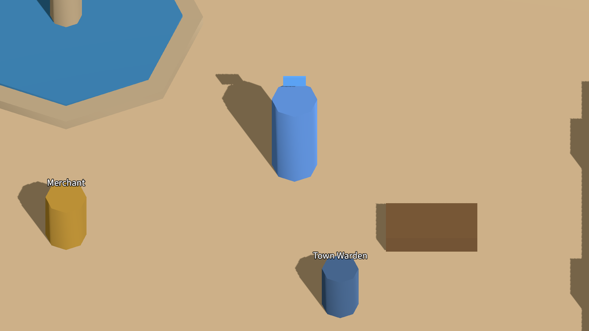
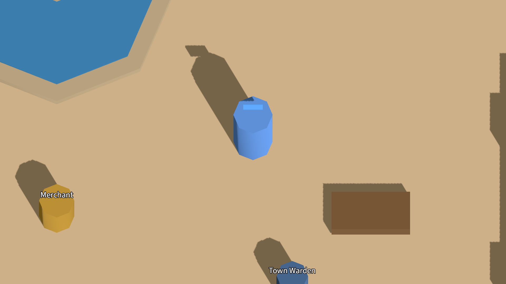
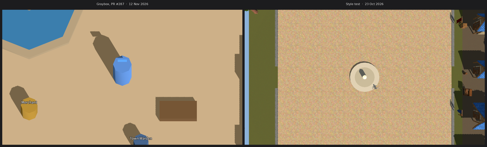
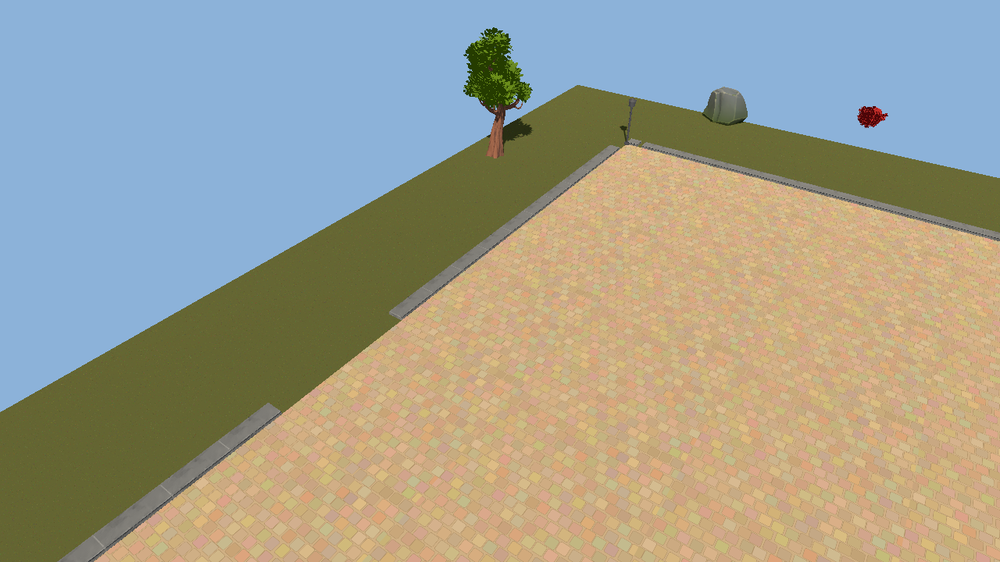
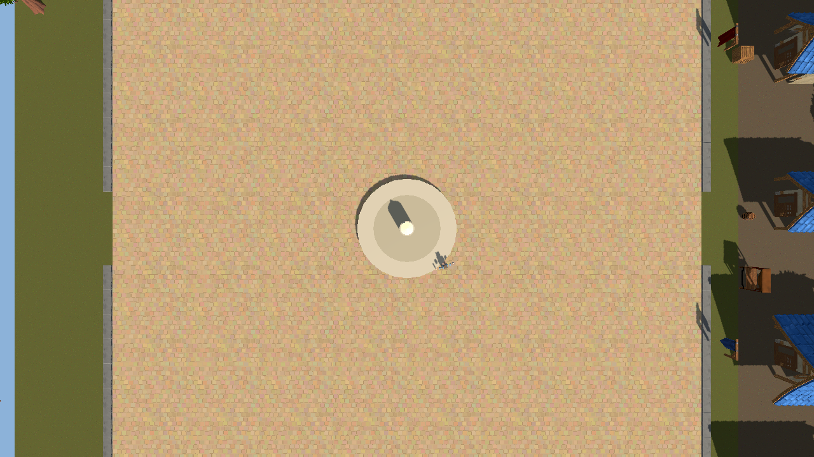

# Nextimus

**Problem:** Build a playable, persistent, online Good-vs-Evil graybox — a playable prototype with placeholder visuals — as a spiritual successor to Xenimus, not a clone, and keep the camera and the agent workflow under human control.  
**Role:** I own the design calls, the numeric camera spec, and the merges. Agents do most of the implementation, test writing, and review drafts. I work with a human collaborator; their agents are credited only as such.  
**Tools:** Godot 4.7.2 (GDScript), Claude Code, GPT Codex, SuperGrok, and the same local Qwen setup I use elsewhere. My agents include Rook (gameplay and tests), Knight (art and UI), and Bishop (review).  
**Outcome:** A LAN graybox that can move, fight, and play through quests, including a camera I specified numerically and a Good-town style test built by Knight.  
**Evidence:** Private, described. Prototype (version 0.1.0 graybox, not a shipped game). I have not copied the private tree into this portfolio. Pull-request counts, issue numbers, and clock times are in the [evidence index](../EVIDENCE.md).  
**Limitations:** This is a LAN graybox, not a shipped MMO. Networking is ENet and is not DTLS-hardened. Some playtests are still flaky. There is no public server.

Nextimus is a [Godot](https://godotengine.org/) 4.7.2 **graybox**: a playable slice with programmer-art visuals, not finished art and not a shipped game. It is a spiritual successor to Xenimus, not a clone, and it has no Xenimus names, spells, towns, or assets.

The slice I can actually stand behind is this: on a LAN, a player can move, fight, and play through quests. There is a command-driven game sim, data-driven items, opt-in PvP, towns and a side cave, pets, merchants, a bot-driven playtest suite, and a headless rule suite. It is still a LAN prototype. Open work includes town dressing, spending attribute and skill points, loot-click rules, encrypting the peer before any public server, and flaky multiplayer playtests.

## The camera call I would not leave to a model

By mid-November the graybox could already do that playable loop, but the follow camera still did not feel like the game I had in my head. I wrote the numeric target myself rather than asking a model to "make it feel close."

The call, in full in [examples/camera-spec.md](../examples/camera-spec.md):

- **Orthographic** projection (no perspective), so the ground scale is even on every side of the player.
- One **size of 7.25 m** (the vertical extent of the view) for both angles. Toggling views changes only the pitch, never the zoom or the framing.
- Camera due south, looking north, 30 m back. In ortho, that distance does not change scale; it just keeps the near plane from clipping.
- The **screen centre is the player's feet**.
- Angled view **50°** down; top-down **72°** down.
- Characters stay authored at about 1.8 m. A **1.25×** scale is applied on the visual node (a bench Knight at 1.81 m becomes about 2.26 m on screen). Walk collision and the 7.5 m/s walk speed stayed where they were; pace was tracked separately.

**Camera spec — human decision → agent implementation → test → approval.** Claude Code implemented that spec. The agent-written pull request reports that on a later head the rule suite passed and a quiet full parallel playtest run passed **44 of 44** scenarios in **458 seconds** at `--playtest-speed=4`. I did not re-run that suite for this portfolio, so I am quoting the pull request, not a fresh log. I merged the change after review.

The close camera also surfaced bugs the far camera had been hiding — including a yard nav path that ran through a training dummy, and playtest clicks that landed off screen. Those fixes went in with the camera work. That is the kind of outcome I want from a tight spec: the numbers stay mine, and the debugging is work I can review.

The two stills below are the 1920×1080 captures from that change, exported under neutral filenames. I reviewed both frames: they show only the Nextimus graybox (programmer-art capsules, a fountain, and the labels Merchant and Town Warden). There is no Xenimus UI or footage, and no account names or file paths.

*Nextimus graybox, Good town square, 50° orthographic follow camera. 1920×1080, captured from the actual in-game camera, with Godot reporting size 7.25 m and the player's feet at the viewport centre. The tall blue capsule is the player.*

*The same player position, 72° top-down view. Same capture conditions as the angled still.*

## Good town square: graybox and style test

The matching scene work lives in the Nextimus tree itself: a Good-town style test built by Knight, my Claude-backed art agent, under my direction. It is an in-engine preview, not a pawn-bench graded run, and not a concept image. The same two camera directions as the graybox stills are below, first as a side-by-side and then as the style-test frames on their own.

I reviewed the style-test frames: no usernames, file paths, terminal text, or Xenimus imagery. Buildings, nature, and props are [Quaternius](https://quaternius.com/) MegaKits (Medieval Village, Stylized Nature, Fantasy Props; **CC0 1.0**). Knight built the fountain, lamp posts, and ground textures for this look test. The original style-test brief specified a 48 × 48 m square. A later issue describes a current playable Good town square of 24 × 24 m at the 7.25 m camera and asks for a still-smaller size; that further shrink was still open in the issue.

*Side by side. Left: Nextimus graybox, Good town square, 50° orthographic follow camera. Right: Good-town style test, angled day view, built by Knight (Claude-backed agent, directed by Kevin). Same place in the game, different stages of art. The style-test frame is mostly the oversized paved square, with kit nature at the far edge. Buildings, nature, and props are Quaternius MegaKits (CC0).*

*Same pairing, 72° top-down graybox and the style-test top-down day view, also built by Knight (Claude-backed agent, directed by Kevin). The style-test fountain sits in the square; Quaternius kit buildings with blue roofs are visible along the right edge.*

*Style test, angled day, 1280×720, built by Knight (Claude-backed agent, directed by Kevin). From the frozen Nextimus-pawn tree. Not a pawn-bench T-task. Kits are Quaternius (CC0).*

*Style test, top-down day. Same source and credit as the angled style-test frame: built by Knight (Claude-backed agent, directed by Kevin). Kits are Quaternius (CC0).*

## How work actually lands

The pipeline is issue → branch → pull request → Bishop review → human merge. Agents do not commit to `main` and do not merge themselves. Playtests are supposed to play like a player: clicks and hotkeys, not debug teleports, unless I have approved a shortcut and opened a "redo" issue. Playtests that start a server or bots are expected to pass **three consecutive** runs at `--playtest-speed=4`. Known flakes stay listed as flakes rather than being weakened until they pass.

Other design contract points — multiplayer-first authoritative server, opt-in PvP, Good and Evil, and no multiclass, durability, or mounts in v1 — were written with the human collaborator.

Networking today is [ENet](https://github.com/lsalzman/enet) on a LAN. It is **not** DTLS-hardened, and an open issue tracks encrypting the peer before any public server. That is a real gap, not a footnote.

More on the pipeline: [architecture/nextimus-pipeline.md](../architecture/nextimus-pipeline.md).
