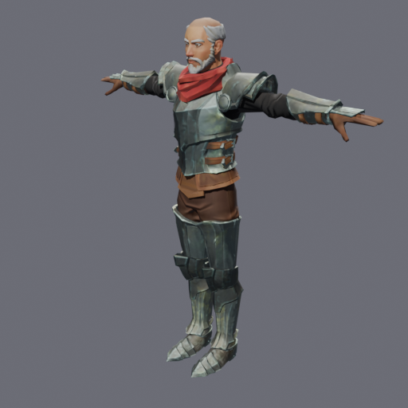
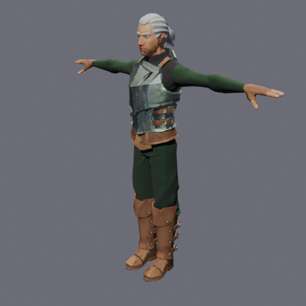
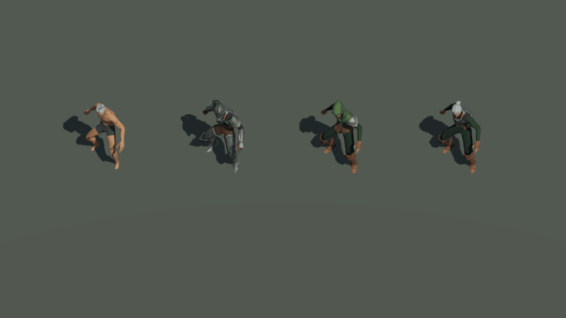
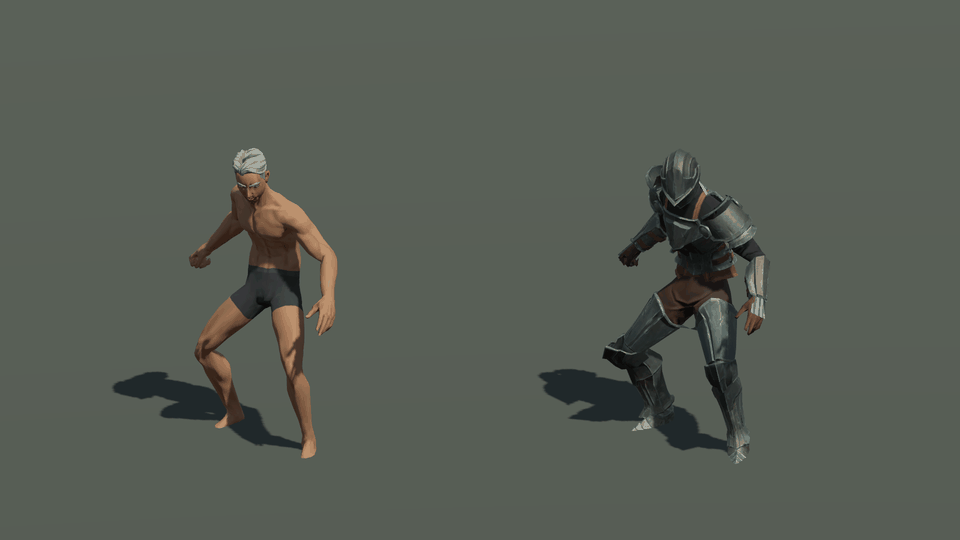
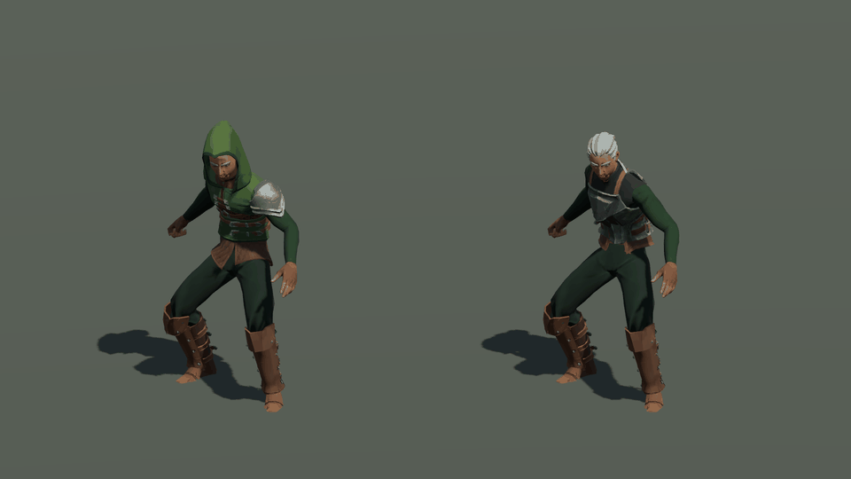

# pawn-bench

**Problem:** I needed a way to grade coding and art agents on frozen Nextimus tasks, instead of judging a chat.  
**Role:** I write the tasks, own the thresholds, stop bad runs, and decide when a checker is wrong. Agents produce the exports the harness grades.  
**Tools:** `run.sh` and the published checkers, Qwen3.6 35B A3B MLX (`q36`) through LM Studio and OpenClaw, Blender 5.3.0, and the house library `tools/pare_lib.py`.  
**Outcome:** On 14 Nov 2026 a sixteen-run overnight set (three passes of T13–T16, then four knight runs of T11 and T12) came back 16/16 PASS on the first try, after I had already tightened the seam and shape rules.  
**Evidence:** Verified in this repo for the harness, the T1–T16 task prompts, the cleaned results summary, and the selected previews in [demos/](../demos/). Transcripts, raw result files, and handoff notes stay private.  
**Limitations:** Prototype / lab tool, not a formal leaderboard. One model, one machine, one night. A full rerun needs a private frozen Nextimus checkout, Quaternius Source packs, Blender, and a local model host; see [REPRODUCING.md](../examples/pawn-bench/REPRODUCING.md).

On 14 Nov 2026 I left a local model to run the knight and kit tasks — three passes of T13–T16, then four knight runs of T11 and T12. That is sixteen runs. It came back **16/16 PASS on the first try**, with 0 fix rounds, 0 infrastructure failures, and 0 timeouts. Knight tasks finished in 72–88 seconds; kit tasks in 483–1,067 seconds.

Treat this as lab notes from one model, one machine, one night — not a claim that the problem is solved in general. Clock times and the per-run checker table are in [RESULTS-SUMMARY.md](../examples/pawn-bench/RESULTS-SUMMARY.md) and the [evidence index](../EVIDENCE.md).

The published copy of the harness lives in [examples/pawn-bench/](../examples/pawn-bench/).

## Why I built a harness instead of watching chats

pawn-bench sits on a **frozen** checkout of Nextimus, with no remotes, so a run cannot wander into later game work. I write the tasks. The harness (`run.sh`) starts an agent, gives it a clean branch, and grades the result with checkers rather than with a vibe.

T1–T7 are Godot / [GDScript](https://docs.godotengine.org/en/stable/tutorials/scripting/gdscript/index.html) tasks: questions, tests, a small feature, a log summarizer, a data-and-code change, a save-compatibility bugfix, and a multi-turn requirement change. T6 starts from an older snapshot (`tasks/T6.base`) so the model has to fix a bug that is already solved on `main`, and a hidden test file sits beside the prompt.

T8–T16 are art-pipeline tasks. The model has to pare [Quaternius](https://quaternius.com/) Source outfits and kits to a triangle, material, seam, and shape budget. In this benchmark a **surface** is one mesh primitive (one rendered material group), and a **loadout** is a combination of equipped pieces — at most one piece per slot, with worn pieces hiding the body regions they cover. Those source packs are **CC0 1.0**. I bought the Source versions; I did not author the meshes. Checkers include `glb_check.py`, `kit_check.py`, `kit_loadout.py`, and `pare_lib.py`.

I use this to compare models and harnesses (OpenClaw versus a direct LM Studio path), and to decide when a rule is strict enough. Stopping a bad run, tightening a threshold, and refusing to count infrastructure failures as model failures are my calls.

Cumulative totals for `q36` plus the house library, including earlier runs, were T11 **5/6**, T12 **3/3**, T13 **7/8**, T14 **4/4**, T15 **4/4**, T16 **4/4**. The two misses are not silent failures from the overnight set. Both were earlier "harness PASS" runs that I (with an agent helping me look) later failed by eye, once the rules got tighter.

## Seam walkthrough

This is the decision I would walk through in an interview.

**Symptom.** A T13 kit run came back a harness PASS, first try, in 667 seconds, with a heaviest loadout well under the 10,000-triangle cap. Looking at the export, the body had cracked along the cuts: only 48% of seam vertices still coincided, against about 94% on a reference build, with gaps up to about a centimetre.

**Why the old check missed it.** The checkers already scored triangle budget, surfaces, look, and shape. None of those measured whether body regions still met edge to edge. The art skill already told the agent not to decimate a region after splitting the body; the model did it anyway (decimate, split, then decimate each region to its own target), and the harness still printed PASS.

**The criterion I chose.** I had a seam check added: among open-edge vertices of one body region that sit within 1 cm of another region's open edge, at least 85% must coincide exactly (`SEAM_MIN = 0.85`, `SEAM_NEAR = 0.01` m). I also had one sentence added to the T13 prompt. The 85% floor sits under the 94% reference share so a clean split has some room; later passing runs landed between 87% and 93%.

**The alternative I considered.** Leaving it as a process rule in the skill, and not adding a numeric check. That is what had just failed: the instruction was already there, and a cracked mesh still passed. I added a measurable share instead of relying on the skill text alone. I also set the floor below the reference 94%, rather than demanding a match to the reference build, so later honest passes at 87–93% still cleared it.

**Implementation review.** I reviewed the new `seams` check in `kit_check.py` and the sentence in the task prompt, then kept the first run as the T13 miss in the 7/8 total.

**Regression proof.** The next T13 run, with the rule in place, passed at 93% coincident seams in 477 seconds. The 14 Nov overnight set ran under that rule and was 16/16. The public fixture includes coincident seams (8 of 8, 100%), a cracked seam (0 of 8, 0%), and a threshold-boundary pair at 85% and 80%.

## Shape limit 4% → 3%

The same week I compared a T11 knight export to its reference in Quick Look and could see rougher armour than a 4% shape limit was supposed to allow. One passing run sat at 3.6%. I lowered the limit to 3%, and that run became the T11 miss in the 5/6 total.

So the 16/16 night is the result *after* those rules existed. The cumulative totals keep the earlier eye-regrades, which is the honest way to write the lab notebook.

## What the agents produced

The art-pipeline tasks are not just assembly. The agent has to join [Quaternius](https://quaternius.com/) Source parts onto one 65-bone armature without re-skinning — every vertex keeps its source UVs, vertex colours, and skin weights — and then **pare the result to a hard triangle budget** while the silhouette stays recognizable (shape error at most 3%). Meshes and art are Quaternius Source packs (**CC0 1.0**); I did not author them. The harness grades that paring and loadout work, not authorship of the meshes or the animation clips.

For T11 and T12 the export must stay at **at most 10,000 triangles and 6 surfaces**. The four source figures in both briefs are about 25,200 + 4,800 + 1,700 + 1,000 triangles, which add to 32,700 — the T12 starting total with the helmet on. The T11 brief (helmet off) then calls the starting total about 31,000 after that helmet is removed, "about one triangle in three kept." The arms alone are about 9,100 triangles in the source.

For T13–T16 every loadout must stay at **at most 10,000 triangles and 12 surfaces**, including the bare body, full Ranger, full Knight, and the heaviest mix. The T15 brief notes that the Knight arms alone are 9,144 triangles in the source, the Ranger boots 9,172.

The stills below are harness preview renders of passing `q36` exports from the 14 Nov 2026 16/16 overnight set. The triangle counts in the captions are from `glb_check.py` / `kit_check.py` in those result files, not from the model's own write-up. The animated GIFs are Godot `Sword_Attack` previews of the T15 **reference kit**, made with the harness `kit_scene` tool on 12 Nov 2026 — not leftover frames from the overnight run. I did not re-run the scene tool on an agent export. Raw `.glb` / `.blend` files are not in this repository.

*T11, male Knight (helmet off). Passing q36 preview from the 14 Nov 2026 16/16 set, graded by the harness. The agent had to pare four Quaternius Source parts — about 31,000 triangles in the task brief after the helmet is removed; the four listed source figures add to about 32,700 with it on — down to at most 10,000 triangles and 6 surfaces, without re-skinning. The checker recorded 9,847 triangles and 4 surfaces. Art is Quaternius (CC0).*

*T15, male hair kit, mixed loadout (ponytail, Knight torso, Ranger arms, legs, and boots). Passing q36 preview from the 14 Nov 2026 16/16 set, graded by the harness. Every loadout has to stay at or under 10,000 triangles and 12 surfaces; the Knight arms alone are 9,144 triangles in the source, the Ranger boots 9,172. On this run the checker recorded 8,623 triangles and 9 surfaces for this mix, and 9,995 for the heaviest loadout. Art is Quaternius (CC0).*

Checker totals for the heaviest loadout (or the whole character, for T11–T12) on all sixteen overnight runs, against a 10,000-triangle cap:

| Task | Runs | Checker result | Surfaces (limit) |
|---|---|---|---|
| T11 (helmet off) | two runs | 9,847 triangles | 4 (max 6) |
| T12 (helmet on) | two runs | 9,847 triangles | 4 (max 6) |
| T13 (male kit) | three runs | heaviest 9,598; 9,660; 9,937 | most 10 (max 12) |
| T14 (female kit) | three runs | heaviest 9,992; 9,990; 9,821 | most 10 (max 12) |
| T15 (male hair kit) | three runs | heaviest 9,977; 9,955; 9,995 | most 10 (max 12) |
| T16 (female hair kit) | three runs | heaviest 9,947; 9,853; 9,908 | most 10 (max 12) |

The published T11 still is the later of the two T11 runs; the published T15 mix still is the mid-pass T15 run (mix 8,623 / 9, heaviest 9,995). The T11 and T12 overnight runs all recorded 9,847 triangles; that figure is the same in each of the four raw checker files, not a copy-paste in this table. Exact start times are in the [results summary](../examples/pawn-bench/RESULTS-SUMMARY.md).

*T15, male hair kit. Animated Sword_Attack preview of the four loadouts (bare, full Knight, full Ranger, and a mix) in the harness Godot test scene. This GIF was rendered from the T15 reference kit on 12 Nov 2026, not from the 14 Nov agent run. The kit_scene log recorded 6,759, 9,460, 9,552, and 8,862 triangles for those four loadouts, each under the 10,000-triangle budget. Meshes and art are Quaternius (CC0). The task keeps the source rig and skin weights so the clips still play.*

*Same T15 reference scene, close view of the bare and full-Knight loadouts during Sword_Attack. Quaternius (CC0) meshes and art; source animations playing on the preserved rig.*

*Same T15 reference scene, close view of the full-Ranger and mix loadouts during Sword_Attack. Quaternius (CC0) meshes and art; source animations playing on the preserved rig.*

More on how a run is wired: [architecture/pawn-bench-harness.md](../architecture/pawn-bench-harness.md).
