# Demos

**Evidence:** Verified in this repo for the Nextimus graybox stills, the Good-town style-test comparison, the five D20 Forge in-app screenshots, and the pawn-bench previews below. There are no paper-trading screenshots, and no synthetic stand-ins.

## Nextimus — Good town square (PR #287)

These are the 1920×1080 captures attached to private PR #287. They were exported from `art/previews/` at commit `e6f69f4` and renamed so the public filenames do not refer to Xenimus. I reviewed both frames on 19 Nov 2026, America/Chicago (CST): programmer-art graybox only; labels are in-game NPC names (Merchant, Town Warden); no Xenimus UI or footage; no account names or paths. PNG metadata is IHDR/sRGB/IDAT/IEND only.

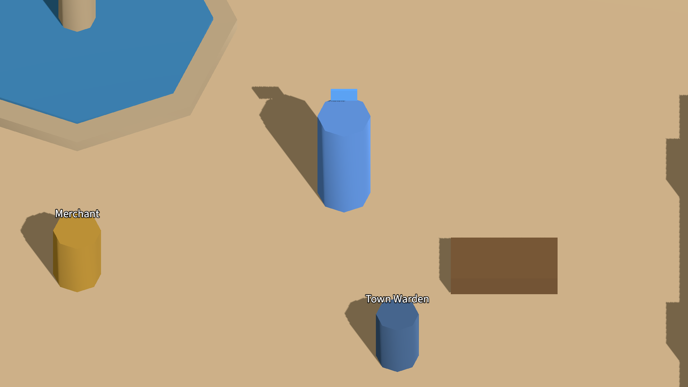

*50° angled follow camera, Good town square. Godot reported orthographic size 7.25 m and the player's feet at the viewport centre. The tall blue capsule is the player.*

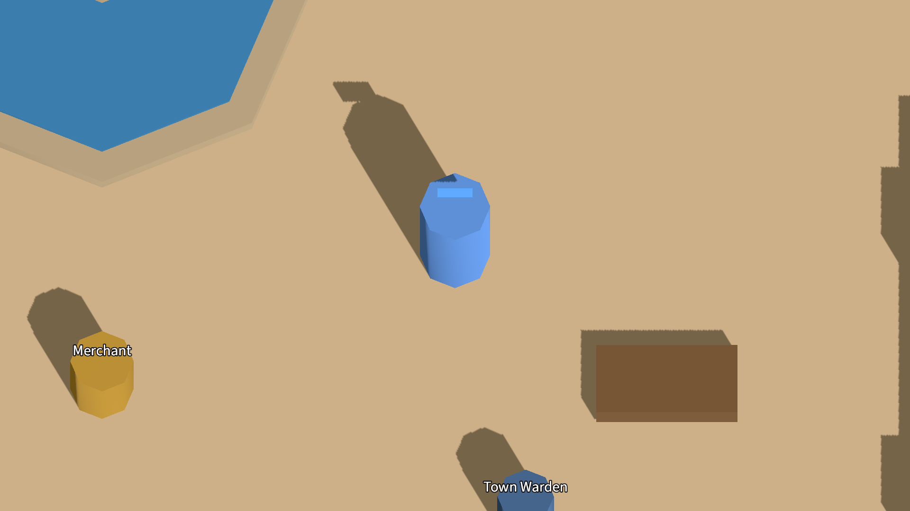

*Same position, 72° top-down view.*

The style-test frames below are in-engine Good-town previews from 23 Oct 2026, 3:36 PM America/Chicago (CDT), commit `55194db` (issue #92, PR #108), in the frozen Nextimus-pawn tree. Knight, my Claude-backed art agent, built the scene under my direction. They are Nextimus scene work, not a pawn-bench T-task — T1–T10 have no town-scene tasks. I reviewed both frames: no usernames, paths, terminal text, or Xenimus imagery. Buildings, nature, and props are Quaternius MegaKits (Medieval Village, Stylized Nature, Fantasy Props; **CC0 1.0**). Knight built the fountain, lamp posts, and ground textures for this look test. The original style-test brief specified a 48 × 48 m square. A later issue describes a current playable Good town square of 24 × 24 m and asks for a still-smaller size; that further shrink was still open in the issue. The two individual style-test frames are 1280×720. The two graybox-vs-style-test composites are 2596×784. Chunks are IHDR/sRGB/IDAT/IEND only.

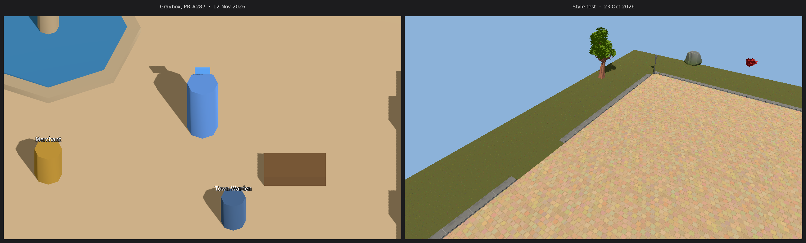

*Side by side. Left: graybox Good town square, 50° follow camera, PR #287, 12 Nov 2026. Right: Good-town style test, angled day, 23 Oct 2026, built by Knight (Claude-backed agent, directed by Kevin). The style-test frame is mostly the oversized paved square, with kit nature at the far edge. Buildings, nature, and props are Quaternius MegaKits (CC0).*

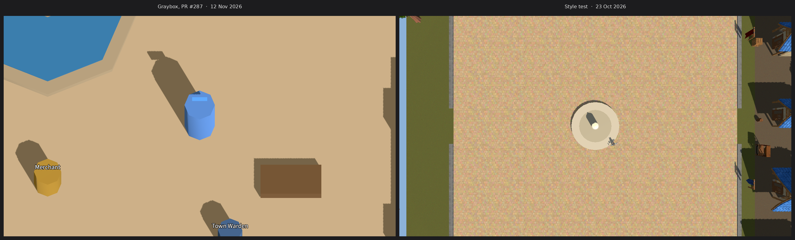

*Same pairing, 72° top-down graybox and the style-test top-down day view, also built by Knight (Claude-backed agent, directed by Kevin). The fountain sits in the square; Quaternius kit buildings with blue roofs are visible along the right edge.*

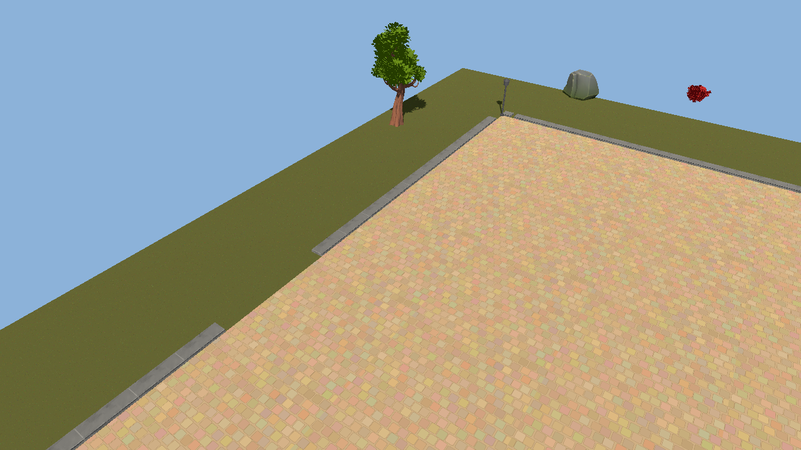

*Style test, angled day, 1280×720, built by Knight (Claude-backed agent, directed by Kevin). Not a pawn-bench T-task. Kits are Quaternius (CC0).*

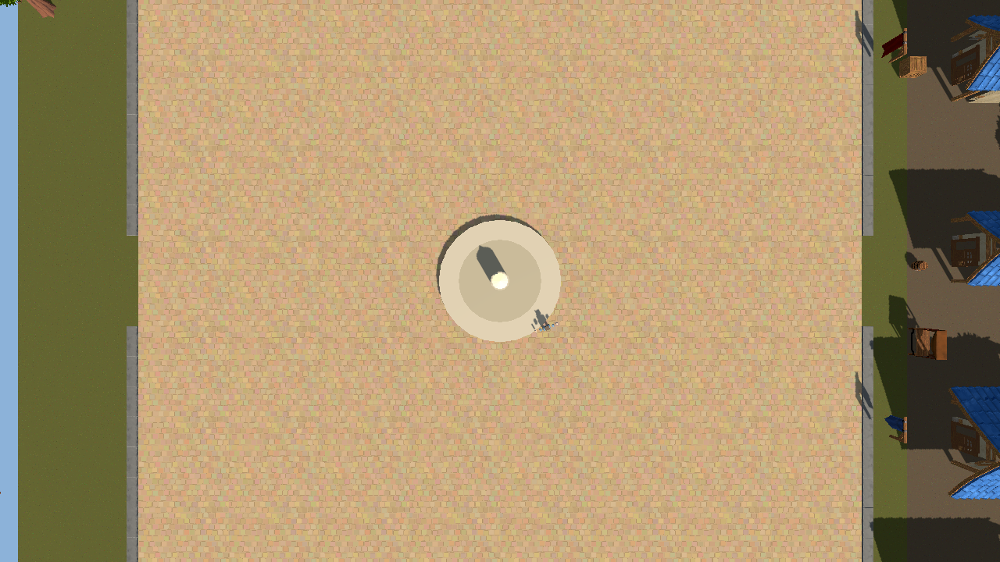

*Style test, top-down day. Same source, date, and credit as the angled style-test frame: built by Knight (Claude-backed agent, directed by Kevin). Kits are Quaternius (CC0).*

File paths in this folder:

- `nextimus-good-town-square-angled-50.png`
- `nextimus-good-town-square-top-72.png`
- `nextimus-good-town-style-test-angled-day.png`
- `nextimus-good-town-style-test-top-day.png`
- `nextimus-good-town-angled-graybox-vs-style-test.png`
- `nextimus-good-town-top-graybox-vs-style-test.png`

## D20 Forge — in-app screens (v0)

iPhone screenshots of the running app (in-app title Realms of Valor). I cropped off the iOS status bar and the "App Store" back label, stripped EXIF and GPS (verified: no APP1 Exif/XMP, no PIL EXIF tags), and resized to 660×1354. Map tiles are Kenney Tiny Town / Tiny Dungeon (**CC0**). Character portraits are from a commercially licensed sprite pack; I did not author those sprites, and the raw sprite files are not in this repository.

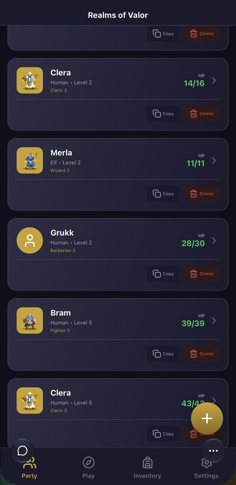

*Party tab, scrolled down, showing two test parties of up to four. Visible here: three members of the level-2 test party I played up from level 1 (Clera, Merla, and Grukk, placeholder initial — Bram is the fourth member of that party, seen in the Haven, Woods, and Inventory stills) and two members of a separate level-5 test party (Bram and a second Clera).*

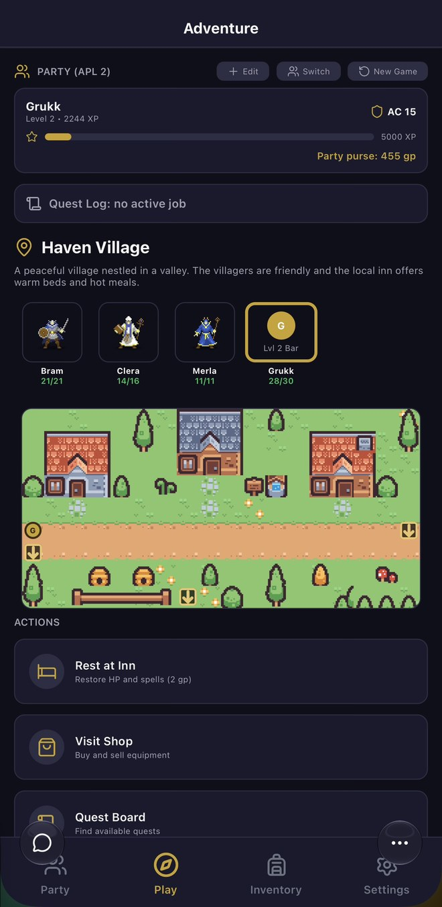

*Adventure tab, Haven Village, with a Kenney-tiled map and inn / shop / quest-board actions.*

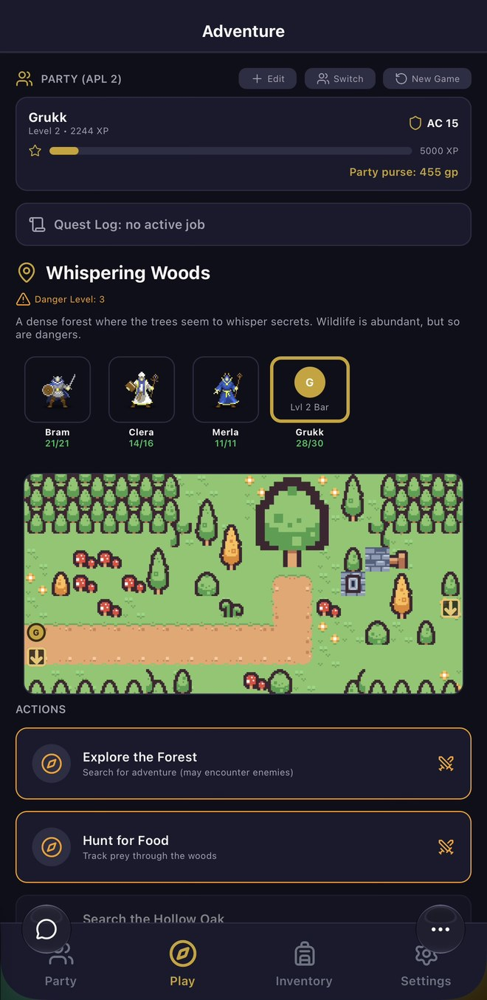

*Adventure tab, Whispering Woods (danger 3), with a Kenney-tiled forest map and explore / hunt actions.*

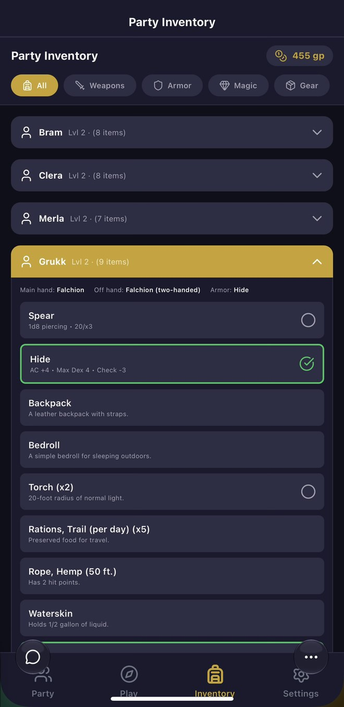

*Party Inventory, Grukk's gear expanded. Party purse 455 gp.*

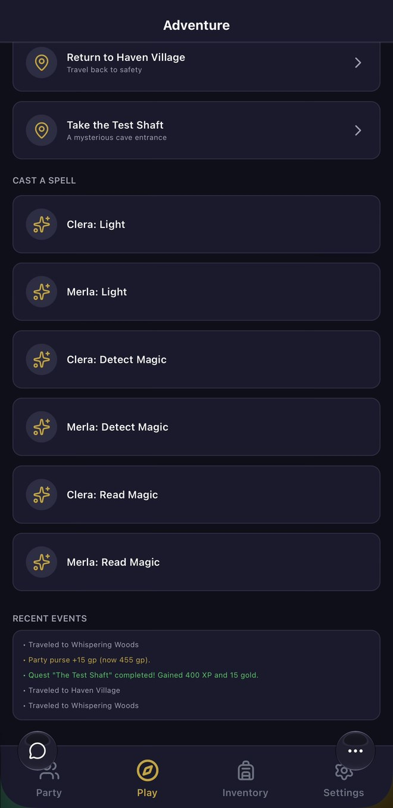

*Adventure tab, scrolled: travel choices, a Cast a Spell list, and a recent-events log.*

File paths in this folder:

- `d20-forge-party.jpg`
- `d20-forge-haven-village.jpg`
- `d20-forge-woods.jpg`
- `d20-forge-inventory.jpg`
- `d20-forge-spells-events.jpg`

## pawn-bench — kit previews and attack loops

Two stills are harness preview renders (512×512) of passing `q36` exports from the 14 Nov 2026 16/16 overnight set. I extracted them from the frozen Nextimus-pawn run branches, stripped Blender text/EXIF/ICC (PNG chunks are IHDR/IDAT/IEND only), and left them at 512 px. The three GIFs are Godot `Sword_Attack` loops (19 frames at 12.5 fps, 80 ms per frame, 960×540, under 1 MB each) from the harness `kit_scene` tool, rendered on 12 Nov 2026, America/Chicago (CST), from the T15 **reference kit** — not from an overnight agent export. I reviewed every frame: characters on a plain backdrop only; no usernames, paths, terminal text, account UI, or Xenimus imagery. Raw `.glb` / `.blend` files are not in this repository.

The work is more than assembly. The agent has to join [Quaternius](https://quaternius.com/) Source parts onto one 65-bone armature without re-skinning, and **pare them to at most 10,000 triangles** (6 surfaces for T11–T12; 12 surfaces per loadout for T13–T16) while keeping source UVs, textures, and skin weights. I did not author those meshes; the packs are **CC0 1.0**. Triangle counts in the captions are from `glb_check.py` / `kit_check.py` in the result files. The full overnight table is in the [pawn-bench case study](../case-studies/pawn-bench.md).

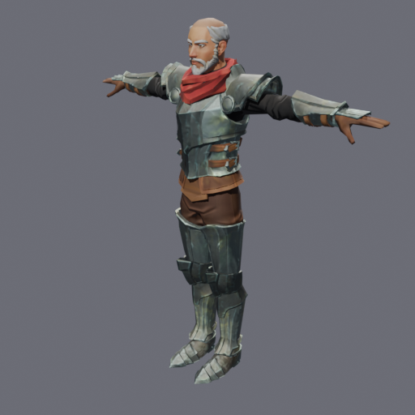

*T11, male Knight (helmet off). Passing q36 preview from the 14 Nov 2026 16/16 set, graded by the harness. The agent had to pare four Quaternius Source parts — about 31,000 triangles in the task brief after the helmet is removed; the four listed source figures add to about 32,700 with it on — down to at most 10,000 triangles and 6 surfaces, without re-skinning. The checker recorded 9,847 triangles and 4 surfaces. Art is Quaternius (CC0).*

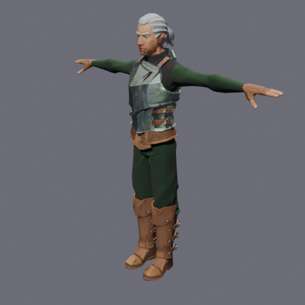

*T15, male hair kit, mixed loadout (ponytail, Knight torso, Ranger arms, legs, and boots). Passing q36 preview from the 14 Nov 2026 16/16 set, graded by the harness. Every loadout has to stay at or under 10,000 triangles and 12 surfaces; the Knight arms alone are 9,144 triangles in the source, the Ranger boots 9,172. On this run the checker recorded 8,623 triangles and 9 surfaces for this mix, and 9,995 for the heaviest loadout. Art is Quaternius (CC0).*

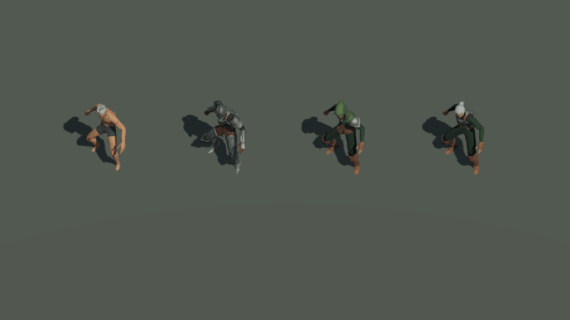

*T15, male hair kit. Animated Sword_Attack preview of the four loadouts (bare, full Knight, full Ranger, and a mix) in the harness Godot test scene. This GIF was rendered from the T15 reference kit on 12 Nov 2026, not from the 14 Nov agent run. The kit_scene log recorded 6,759, 9,460, 9,552, and 8,862 triangles for those four loadouts, each under the 10,000-triangle budget. Meshes and art are Quaternius (CC0). The task keeps the source rig and skin weights so the clips still play.*

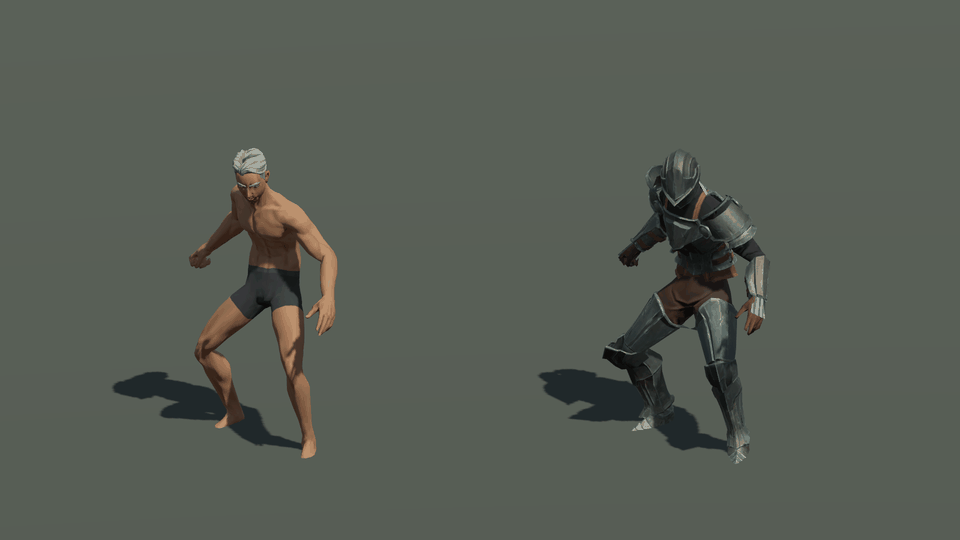

*Same T15 reference scene, close view of the bare and full-Knight loadouts during Sword_Attack. Quaternius (CC0) meshes and art; source animations playing on the preserved rig.*

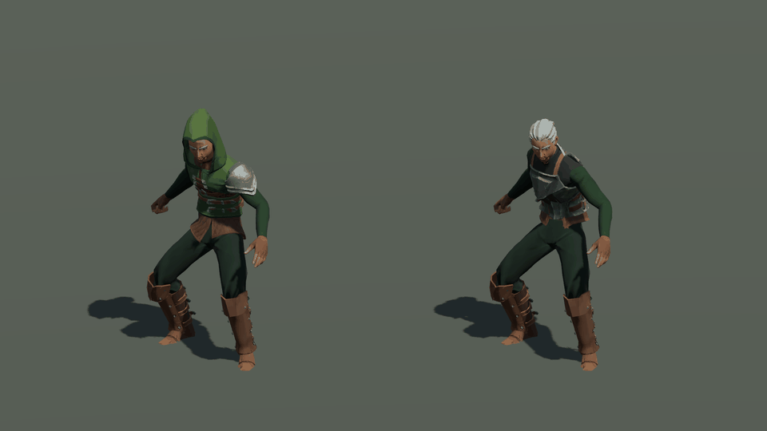

*Same T15 reference scene, close view of the full-Ranger and mix loadouts during Sword_Attack. Quaternius (CC0) meshes and art; source animations playing on the preserved rig.*

File paths in this folder:

- `pawn-bench-t11-knight-threequarter.png`
- `pawn-bench-t15-male-kit-mix.png`
- `pawn-bench-t15-sword-attack-angled.gif`
- `pawn-bench-t15-sword-attack-close1.gif`
- `pawn-bench-t15-sword-attack-close2.gif`

## Other projects

- **pawn-bench.** The harness and the [cleaned 16/16 results summary](../examples/pawn-bench/RESULTS-SUMMARY.md) are still the main artifacts. Selected previews are in the section above; transcripts and raw result files stay private.
- **paper-trading-runner.** No dashboard screenshots are included. The artifact is the described safety behavior (paper only, live-key refusal) plus the dated commit trail, not a ledger or a running host. The case study mentions the research tab (news, public U.S. House filings, IPO / S-1) at a high level only.
